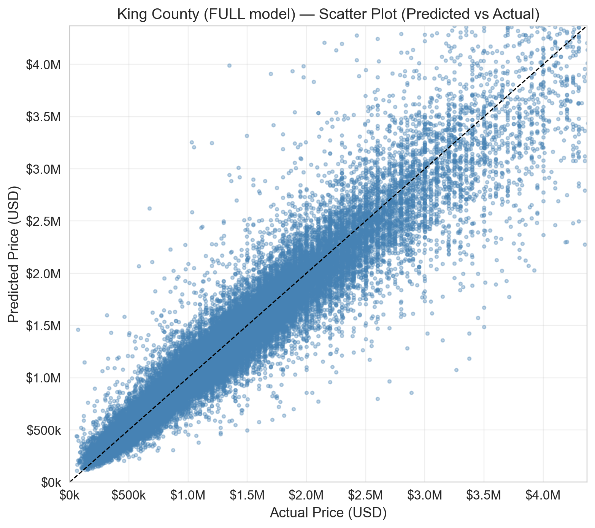

# Housing Prediction with Economic Indicators

[← Portfolio home](../../../README.md) · [Machine Learning projects](../../../README.md#machine-learning)

> **Publication status:** Code and saved evaluation included.

## Research question

How can housing records be joined with economic indicators and evaluated using cross-validation?

## Dataset

King County Sales; FRED MORTGAGE30US, CUUSA423SA0, SEAT653URN and PCPI53033

## Tools and methods

Python, rdata, pandas, XGBoost, PyTorch-based TabNet and Jupyter

## What I implemented

- Built a 229,046-row, 55-column housing dataset by joining mortgage rates, Seattle CPI, Seattle unemployment and King County per-capita income to sales records.
- Converted R-format records, aligned different reporting frequencies to sale dates and checked indicator coverage. Extended the model notebook with structural/full-feature comparisons, fold metrics, feature importance, residual plots and out-of-fold predictions.

## Results and limitations

The local TabNet run used a shorter configuration and is not claimed to reproduce the dissertation scores.

### Saved five-fold XGBoost evaluation

These are the local economic-indicator notebook outputs, distinct from the dissertation. R² is measured on log-transformed prices; MAE is in US dollars.

| Region, full features | Mean log-price R² | Mean MAPE | Mean MAE |
|---|---:|---:|---:|
| Seattle | 0.8983 | 10.03% | $101,988 |
| Rest of King County | 0.9601 | 7.89% | $79,058 |

[Fold-by-fold metrics](results/) · [Housing notebook](KingCounty_Housing_Prediction_with_Economic_Indicators.ipynb) · [Economic-data join](build_kingcounty_finance_join.py)

Economic variables are aligned by observation dates; real-time release vintages have not been established. Results are not presented as a validated future-price forecasting benchmark. The short local TabNet configuration does not reproduce the dissertation comparison.

## Data access and attribution

Raw datasets, trained model binaries and private operational records are not redistributed. Dataset ownership remains with the respective providers. Where upstream research implementations were adapted, the description distinguishes those methods from local engineering contributions.
